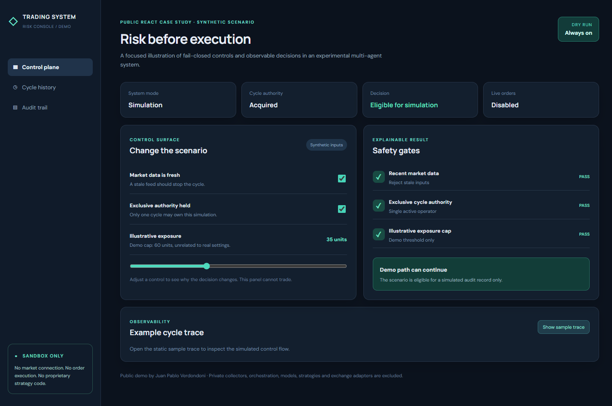

# Trading System · public risk demo



An isolated **React + Vite** interface plus a **Python agent infrastructure sample**. The UI visualizes fail-closed controls and an audit trace. Every event and parameter is fictional. The `evaluateDemo` function is generic teaching code, **not** the private risk engine or trading logic.

The Python [agent_sample](agent_sample) is **adapted from mechanisms in the private project**, rather than a copy of its modules: parallel agent orchestration with timeout and partial-failure isolation, a cycle-scoped shared brain, a news-review agent with two injected sources, a bounded LLM reviewer, and a testable Claude API boundary. The optional Anthropic adapter makes a real SDK call only when explicitly instantiated with a key and model ID. Tests use fake transports and sources. See [provenance and limits](docs/02-arquitectura/EXTRACCION_AGENTES.md).

The private project uses Python orchestration, a market-data collector, PostgreSQL, an exchange adapter, agent components and an operational dashboard. In its documented Railway configuration, Railway runs the **collector and dashboard only**; trading and shadow cycles run locally against the same database. This public UI is a new presentation sample and does not claim to be the private dashboard or a production trading deployment.

No exchange API, model, strategy, order endpoint, real credential, market feed or proprietary parameter is present. **Live order execution is impossible** from this repository.

## Run

```bash
npm install
npm run dev
```

Run `npm test` for the published React behavior, `npm run build` for a production bundle check, and `python -m unittest discover -s agent_sample -p 'test_*.py' -v` for the 30 agent tests. The [documentation index](docs/00-indice/INDICE.md) contains the public specification, SDD, decisions, walkthrough and test strategy. These tests verify this isolated extraction, **not** the full private engine, market data or exchange adapters.

## What to inspect

- `src/App.jsx`: pure illustrative control evaluation, state driven gates and conditional trace.
- `src/styles.css`: responsive monitoring interface.
- The UI explains failed controls instead of quietly proceeding.
- `agent_sample/agents.py`: real agent workflow pattern with injected sources, deduplication, LLM analysis, fail-soft source handling and shared state.
- `agent_sample/reviewer.py`: second LLM agent with a deterministic gate; rejected inputs cannot be promoted by the model.
- `agent_sample/orchestrator.py`, `brain.py`, `llm.py`: parallelism, cycle isolation and Claude SDK boundary.
- `agent_sample/test_agent_sample.py`: 30 deterministic tests including actual parallelism, retry, timeout, invalid JSON, source failures, cycle isolation and bounded review.

**Scope:** Limited public sample of engineering principles, not financial advice and not a deployable trading system. Designed and implemented by Juan Pablo Verdondoni.

Copyright © Juan Pablo Verdondoni. No reuse license is granted for this public sample.
