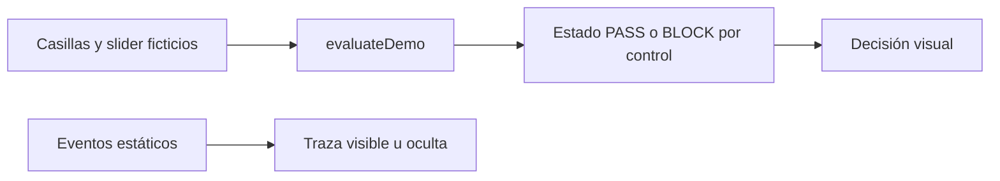

# SDD · Consola pública de controles

**Estado:** implementado. Referencia: `src/App.jsx`. La función `evaluateDemo` es una regla didáctica de la muestra; no representa el algoritmo de riesgo, un contrato de API ni una estrategia privada.

## 1. Arquitectura del repositorio

SPA React/Vite local, sin API, almacenamiento, socket ni credenciales. `fresh`, `lease`, `exposure` y `showTrace` viven en estado React. `result` se calcula con `useMemo` en cada cambio pertinente.

## 2. Contrato ilustrativo

`evaluateDemo({ fresh, lease, exposure })` genera tres checks con nombre, resultado y nota. `allowed` es verdadero sólo cuando los tres pasan. El único umbral numérico, `exposure <= 60`, se inventó para permitir probar un borde; **no es un parámetro real**. La UI lo identifica como `Demo cap`.

## 3. Decisión y fallo cerrado

Con datos frescos, autoridad exclusiva y exposición dentro del límite, se muestra `Eligible for simulation` y el mensaje aclara que, como máximo, podría producirse un registro de auditoría simulado. Cualquier condición falsa muestra `Blocked` y `Fail closed: demo path stopped`. No hay una transición a ejecución: `Live orders` permanece `Disabled` cualquiera sea la decisión.

La traza `SIM-*` es una secuencia estática de ejemplo y no se genera al mover controles. Abrirla sólo cambia la presentación. No se presenta como un log real.

## 4. Flujos y bordes

1. Estado inicial: las tres verificaciones pasan y se muestra una decisión sólo de simulación.
2. Desactivar frescura: aparece un control bloqueado.
3. Restablecerla y desactivar autoridad: el ciclo queda bloqueado y `Cycle authority` dice `Missing`.
4. Subir exposición a 60: pasa; a 61: bloquea; volver a 0: pasa.
5. Mostrar y ocultar traza: cuatro eventos sintéticos, sin modificación de la evaluación.

## 5. Trazabilidad

| Requisito | Implementación | Prueba |
| --- | --- | --- |
| TS-01 | Modo y checks iniciales | `defaults to simulated...` |
| TS-02 | `fresh`, `lease`, `evaluateDemo` | `stale data...`, `missing exclusive...` |
| TS-03 | Slider y comparación inclusiva | `illustrative cap passes...` |
| TS-04 | `showTrace`, `sampleEvents` | `sample trace...` |
| TS-05 | Vite, Vitest, workflow | `npm test`, `npm run build` |

## 6. Riesgos de interpretación

Las pruebas no demuestran seguridad financiera, exclusión distribuida real, calidad de datos de mercado, exactitud de un modelo ni seguridad de órdenes. El diseño mantiene separada la muestra pública de esos componentes privados.
